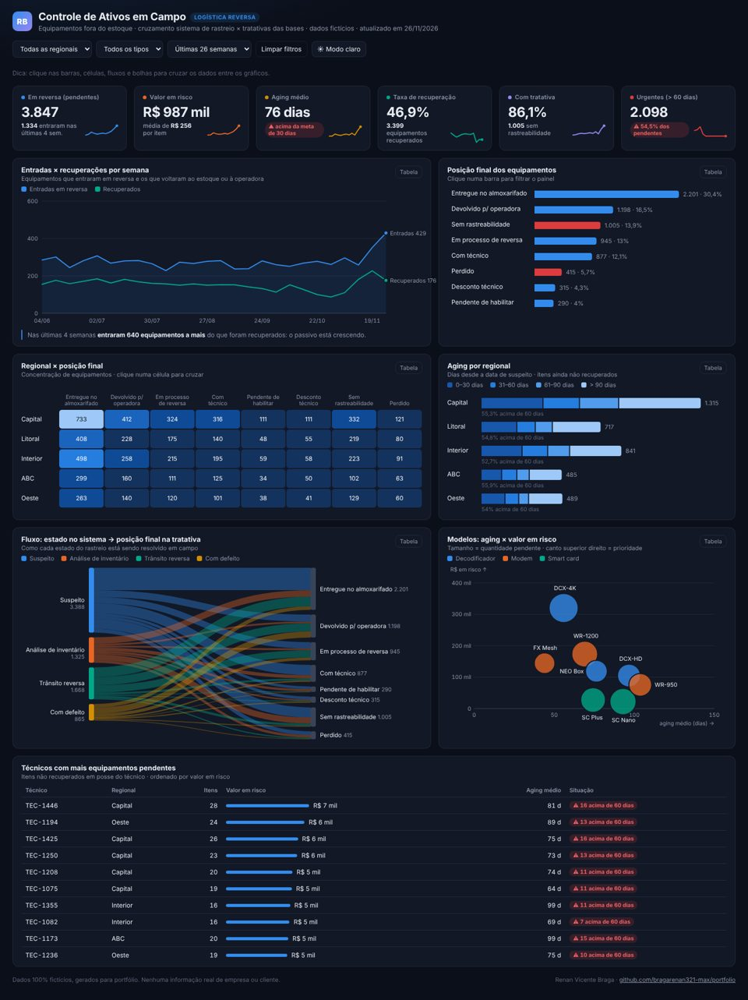
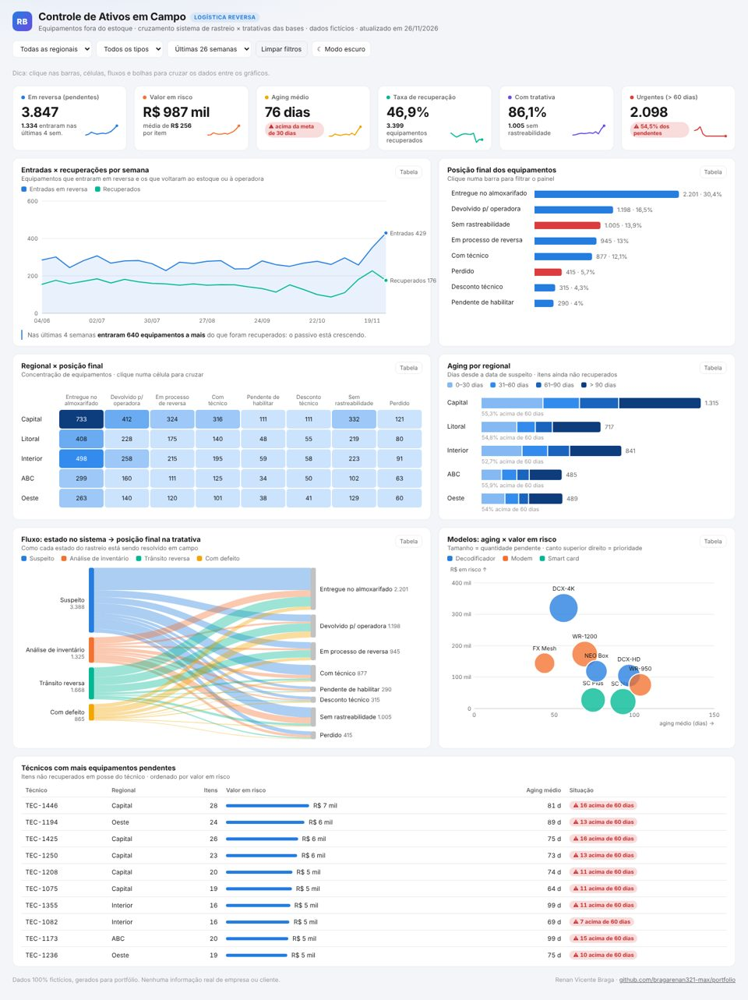

# Renan Vicente Braga · Portfólio de dados e automação

Auxiliar administrativo em operação de telecomunicações, com foco em **controle operacional, auditoria e automação de rotinas** com Excel, VBA, Python, Looker Studio e IA generativa.

Todos os projetos abaixo usam **dados 100% fictícios**. Eles reproduzem problemas reais do dia a dia de operações (extrações bagunçadas, conferência manual, observações em texto livre), sem expor informação de nenhuma empresa.

## Projetos

### 1. Painel de controle de ativos em campo
Painel interativo de logística reversa: KPIs, tendência semanal, mapa de calor regional × posição final, fluxo (sankey) do estado no sistema até a tratativa, aging, valor em risco por modelo e técnicos com pendências. **Todos os gráficos se filtram entre si:** clique numa barra, célula, fluxo ou bolha.

| Modo escuro | Modo claro |
|---|---|
|  |  |
| **[Abrir o painel escuro](https://bragarenan321-max.github.io/portfolio/dashboard/painel-escuro.html)** | **[Abrir o painel claro](https://bragarenan321-max.github.io/portfolio/dashboard/painel-claro.html)** |

HTML, CSS e JavaScript puros, sem bibliotecas. Paleta de cores validada para daltonismo nos dois temas, tooltips em todos os gráficos e visão em tabela para acessibilidade.

### 2. [Consolidador de relatórios (Excel/VBA)](automacao-excel-vba/)
Junta várias extrações com colunas em ordens diferentes e formatos inconsistentes num relatório padronizado: converte códigos, datas e números, padroniza textos por uma tabela de regras, busca valores em tabelas de apoio e gera uma aba de conferência (OK / ATENÇÃO / ERRO). Tudo configurável por abas, sem mexer no código.

### 3. [Classificador de observações com IA (Python + Claude)](automacao-ia-python/)
Transforma observações em texto livre de técnicos de campo em dados estruturados (categoria, data prometida, ação necessária, confiança) usando a API do Claude, com validação da resposta e regras de segurança. Tem modo demonstração para rodar sem chave de API.

## Ferramentas

`Excel` (Power Query, tabelas dinâmicas, VBA) · `Python` (pandas) · `SQL` · `Looker Studio` · `Google Sheets` · `SAP` · `IA generativa (Claude)`

## Sobre o uso de IA

Uso IA generativa como ferramenta de trabalho para acelerar a construção de automações. Em todos os projetos, eu defino o problema e as regras de negócio, testo com os dados, identifico os erros e decido as correções. Os READMEs de cada projeto contam essas decisões.

---
[LinkedIn](https://www.linkedin.com/in/renan-braga-7530b6229) · bragarenan321@gmail.com
